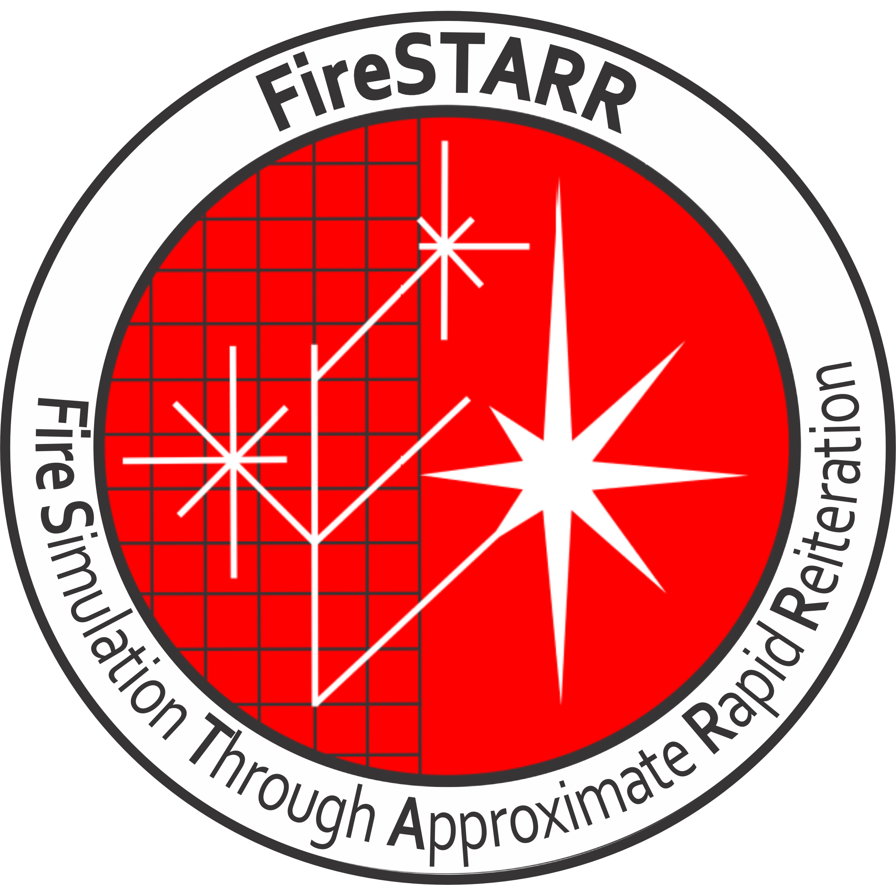
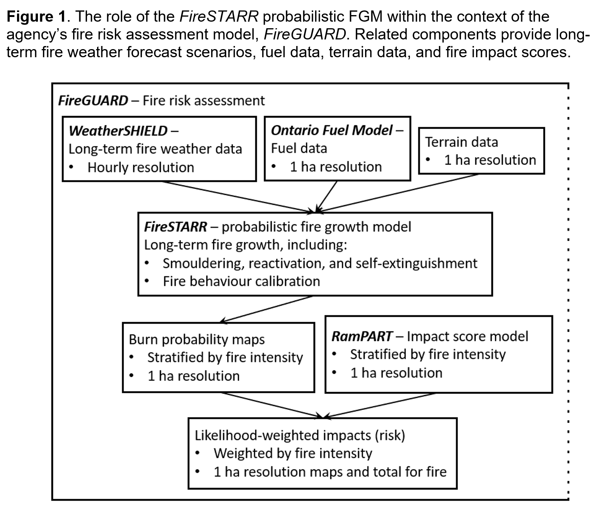

###

# ***THIS REPOSITORY IS A WORK IN PROGRESS AND NOT TO BE TAKEN AS FACT.***
# ***WE ASSUME NO LIABILITY FOR ANY USAGE, BY ANYONE, UNDER ANY CIRCUMSTANCES***

###


## Table of Contents

- [***THIS REPOSITORY IS A WORK IN PROGRESS AND NOT TO BE TAKEN AS FACT.***](#this-repository-is-a-work-in-progress-and-not-to-be-taken-as-fact)
- [***WE ASSUME NO LIABILITY FOR ANY USAGE, BY ANYONE, UNDER ANY CIRCUMSTANCES***](#we-assume-no-liability-for-any-usage-by-anyone-under-any-circumstances)
    - [](#-1)
  - [Table of Contents](#table-of-contents)
    - [](#-2)
- [About FireSTARR](#about-firestarr)
- [FireSTARR](#firestarr)
  - [Documentation](#documentation)
    - [Additional Resources](#additional-resources)
  - [Usage](#usage)
    - [General Syntax](#general-syntax)
  - [Additional License Condition](#additional-license-condition)


This repository is to provide documentation regarding the FireSTARR model, located at:
- https://github.com/cwfmf/firestarr 

###

# About FireSTARR



# FireSTARR

FireSTARR is a wildfire simulation and burn probability modelling system designed to support wildland fire response decision-making.

FireSTARR is designed to support wildland fire response decision-making, and is the fire growth algorithm originally in the FireGUARD suite of programs.

It focuses on the generation of burn probabilities from replicated simulation of fire growth, smouldering, and natural extinction under the weather and stochastic fire behaviour scenarios.



## Documentation

📖 **Full technical documentation:**

https://cwfmf.github.io/firestarr/


### Additional Resources

- User Guide: https://cwfmf.github.io/firestarr-cpp/
- Settings Reference: https://cwfmf.github.io/firestarr-cpp/settings.html
- Command Line Reference: https://cwfmf.github.io/firestarr-cpp/usage.html

- FireGUARD:
  - [*History and overview of research and development for Ontario’s FireGUARD decision support system for appropriate response*](https://pubs.cif-ifc.org/doi/10.5558/tfc2025-015)
  - [*Behind the FireGUARD – background & technical summary*](https://pubs.cif-ifc.org/doi/suppl/10.5558/tfc2025-015/suppl_file/tfc2025-015supp1.pdf)
- WeatherSHIELD:
  - [*Assembling and Customizing Multiple Fire Weather Forecasts for Burn Probability and Other Fire Management Applications in Ontario, Canada*](https://doi.org/10.3390/fire3020016)
  - [*Behind the WeatherSHIELD – background & technical summary*](https://pubs.cif-ifc.org/doi/suppl/10.5558/tfc2025-015/suppl_file/tfc2025-015supp2.pdf)
  - [*WeatherSHIELD: probabilistic fire weather forecasts*](https://pubs.cif-ifc.org/doi/suppl/10.5558/tfc2025-015/suppl_file/tfc2025-015supp3.pdf)
- RamPART:
  - [*Impacts of wildland fire effects on resources and assets through expert elicitation to support fire response decisions*](https://doi.org/10.1071/WF18189)
  - [*RamPART: Fire Effects and Impacts for Risk Assessment in FireGUARD*](https://pubs.cif-ifc.org/doi/suppl/10.5558/tfc2025-015/suppl_file/tfc2025-015supp4.pdf)
- FireSTARR:
  - *FireSTARR: a fast probabilistic forest fire growth model using approximate wavelet geometry* (in progress)
  - [*FireSTARR: burn probability mapping*](https://pubs.cif-ifc.org/doi/suppl/10.5558/tfc2025-015/suppl_file/tfc2025-015supp5.pdf)
  - [Example – large fire from perimeter](https://pubs.cif-ifc.org/doi/suppl/10.5558/tfc2025-015/suppl_file/tfc2025-015supp6.pdf)
  - [Example – 10 ha fire, with no perimeter](https://pubs.cif-ifc.org/doi/suppl/10.5558/tfc2025-015/suppl_file/tfc2025-015supp7.pdf)
  - [Example – small fire from a point source ignition](https://pubs.cif-ifc.org/doi/suppl/10.5558/tfc2025-015/suppl_file/tfc2025-015supp8.pdf)


## Usage

Specifies the arguments for use when using FireSTARR.

**Type:** `string`  
**Required:** Yes  
**Default:** None

### General Syntax

```text
firestarr.exe <output_dir> <yyyy-mm-dd> <lat> <lon> <HH:MM> [OPTION]...

Usage: firestarr.exe <output_dir> <yyyy-mm-dd> <lat> <lon> <HH:MM> [OPTION]...

Run simulations and save output in the specified directory

Usage: firestarr.exe surface <output_dir> <yyyy-mm-dd> <lat> <lon> <HH:MM> [OPTION]...

Calculate probability surface and save output in the specified directory

.\firestarr.exe Output_Fire 2026-05-01 53 -100 13:00 \
    --ffmc 80 \
    --dmc 60 \
    --dc 300 \
    --tz 8

Input Options

  -h                        Show help
  -v                        Increase output level
  -q                        Decrease output level

  --ascii                   Save grids as .asc
  --no-tiff                 Do not save grids as .tif

  -i                        Save individual maps for simulations
  -s                        Run in synchronous mode

  --points                  Save simulation points to file
  --no-intensity            Do not output intensity grids
  --no-probability          Do not output probability grids
  --occurrence              Output occurrence grids
  --sim-area                Output simulation area grids

  --raster-root             Use specified directory as raster root
  --fuel-lut                Use specified fuel lookup table

  --tz                      UTC offset (hours)
  --curing                  Specify static grass curing
  --force-greenup           Force green up for all fires
  --force-no-greenup        Force no green up for all fires

  --log                     Output log file
  --wx                      Input weather file

  --deterministic           Run deterministically
                             (100% chance of spread & survival)

  --confidence              Use specified confidence level

  --perim                   Start from perimeter
  --size                    Start from size

  --ffmc                    Startup Fine Fuel Moisture Code
  --dmc                     Startup Duff Moisture Code
  --dc                      Startup Drought Code

  --apcp_prev               Startup precipitation between
                             1200 yesterday and start of
                             hourly weather

  --output_date_offsets     Override output date offsets
```

## Additional License Condition

All covered works (e.g., copies of this work, derived works) must include a copy of the file (or an updated version of it) that details credits for work up to the time of the original open source release. That file is available [here](https://github.com/CWFMF/FireSTARR/blob/main/ORIGIN.md).
